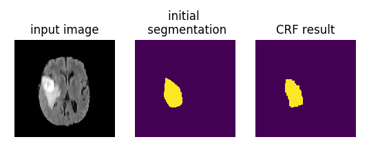
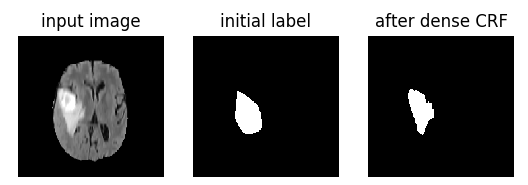
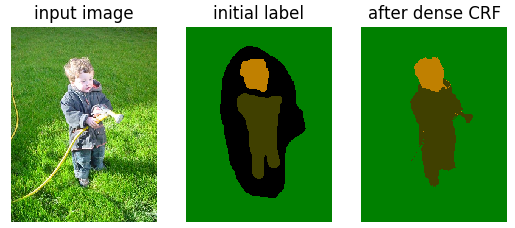

# SimpleCRF
Matlab and Python wrap of Conditional Random Field (CRF) and fully connected (dense) CRF for 2D and 3D image segmentation. This repository was part of the work in Slic-Seg for interactive image segmentation. If you use this code, please cite the following paper:

* G. Wang, M. A. Zuluaga, R. Pratt, M. Aertsen, T. Doel, M. Klusmann, A. L. David, J. Deprest, T. Vercauteren, and S. Ourselin. 
[Slic-Seg: A Minimally Interactive Segmentation of the Placenta from Sparse and Motion-Corrupted Fetal MRI in Multiple Views.][Media2016] Medical Image Analysis. 34, 2016, pp. 137-147.

[Media2016]:https://www.sciencedirect.com/science/article/pii/S1361841516300287

BibTeX entry:

    @article{WANG2016137,
    title = {Slic-Seg: A minimally interactive segmentation of the placenta from sparse and motion-corrupted fetal MRI in multiple views},
    journal = {Medical Image Analysis},
    volume = {34},
    pages = {137-147},
    year = {2016},
    issn = {1361-8415},
    doi = {https://doi.org/10.1016/j.media.2016.04.009},
    author = {Guotai Wang and Maria A. Zuluaga and Rosalind Pratt and Michael Aertsen and Tom Doel and Maria Klusmann and Anna L. David and Jan Deprest and Tom Vercauteren and Sébastien Ourselin}
    }

The CRF and DenseCRF algorithms are from the following papers:

[1] Yuri Boykov and Vladimir Kolmogorov, "An experimental comparison of min-cut/max-flow algorithms for energy minimization in vision", IEEE TPAMI, 2004.

[2] Philipp Krähenbühl and Vladlen Koltun, "Efficient inference in fully connected crfs with gaussian edge potentials", in NIPS, 2011.

[3] Kamnitsas et al in "Efficient multi-scale 3D CNN with fully connected CRF for accurate brain lesion segmentation", Medical Image Analysis, 2017.





### Dependency
This repository depends on the following packages:
[`Maxflow`](https://vision.cs.uwaterloo.ca/code/),
[`DenceCRF`](http://graphics.stanford.edu/projects/drf/) and 
[`3D Dense CRF`](https://github.com/deepmedic/dense3dCrf)

### Installation
Numpy>=2.0.0 is required for the latest version. 

1. Install by pip: [`pip install SimpleCRF`](https://github.com/taigw/SimpleCRF)

2. Alternatively, you can compile the source files by the following two steps:
```bash
python setup.py build
python setup.py install
```

### Examples
Some demos of using this package are:

* `examples/demo_maxflow.py`: using maxflow for automatic and interactive segmentation of 2D and 3D images.

* `examples/demo_densecrf.py`: using dense CRF for 2D gray scale and RGB image segmentation.

* `examples/demo_densecrf3d.py`: using 3D dense CRF for 3D multi-modal image segmentation.

### Modules
1. `maxflow` has four functions as follows. Note that the current version only supports binary segmentation.

* `maxflow.maxflow2d()` for 2D automatic segmentation.

* `maxflow.interactive_maxflow2d()` for 2D interactive segmentation.

* `maxflow.maxflow3d()` for 3D automatic segmentation.

* `maxflow.interactive_maxflow3d()` for 3D interactive segmentation.

2. `denseCRF` has the following function. It can deal with multi-class segmentation, and only supports RGB images.

* `denseCRF.densecrf()` for 2D automatic segmentation.

3. `denseCRF3D` has the following function. It can deal with multi-class segmentation. The input channel number can be 1-5.

* `denseCRF3D.densecrf3d()` for 3D automatic segmentation.


